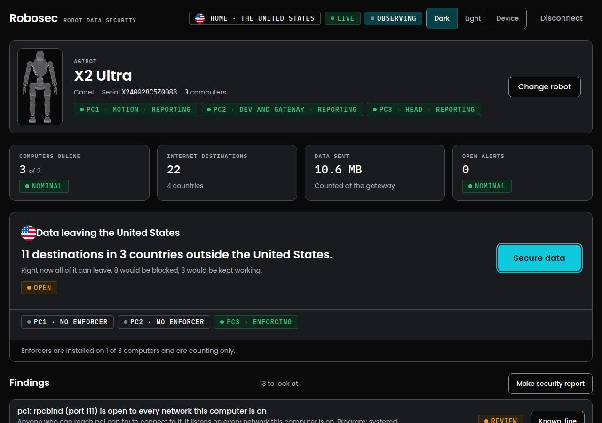
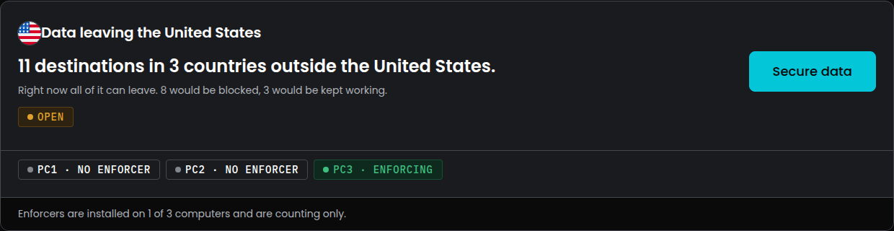
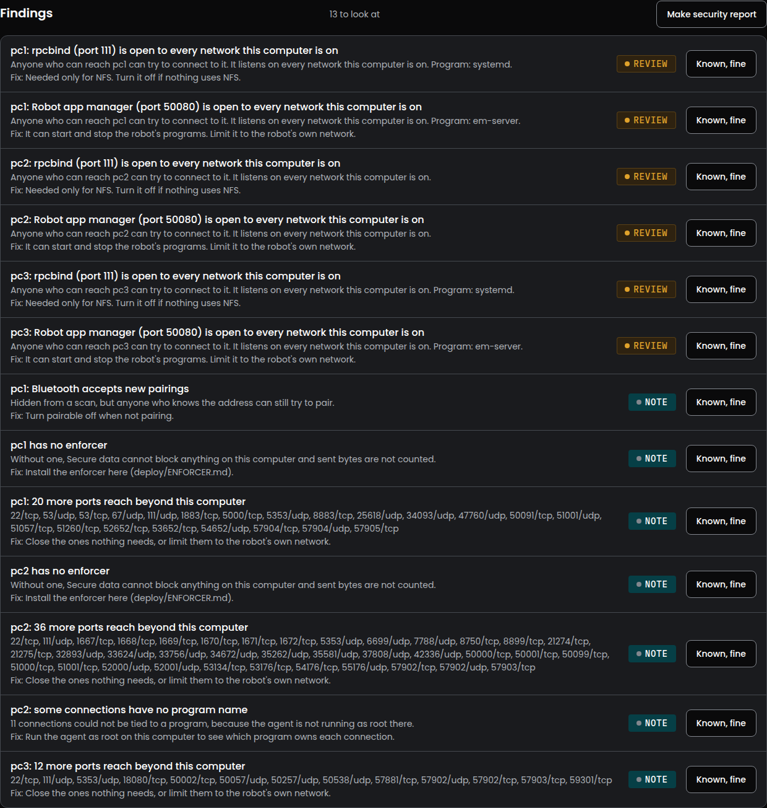
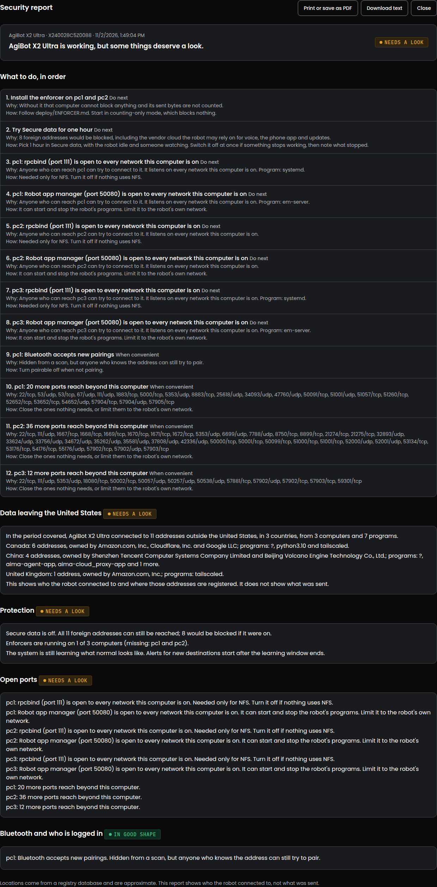
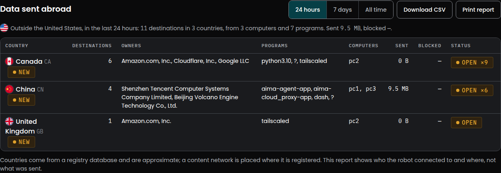
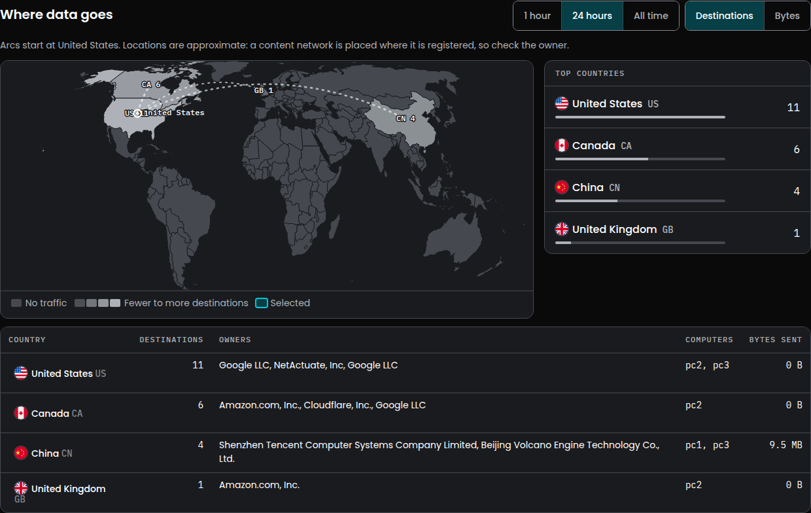
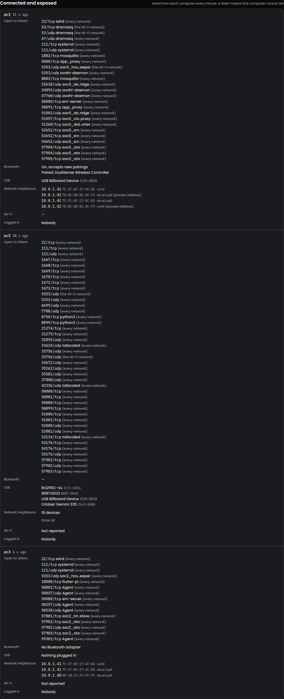

# Robolink-cyber

Robot data security for the AgiBot X2 "Cadet" (also AgiBot A3 and Unitree G1 profiles): see who the robot talks to, where in the world they are,
what is exposed, and switch off data leaving the home country. The project lives in [`robo-data-security/`](robo-data-security/) (robosec, stdlib Python 3.10+).

## What it looks like

Live dashboard on the Cadet (AgiBot X2 Ultra). Every part is explained in [`robo-data-security/docs/DASHBOARD.md`](robo-data-security/docs/DASHBOARD.md).

| | |
|---|---|
| **Secure data**: block everything outside the home country, 1 hour to until off  | **Findings**: what could be wrong, with the fix  |
| **Security report**: a rating and what to do, in order  | **Data sent abroad**: by country, owner and program, with CSV and print  |
| **Where data goes**: map of the robot's destinations  | **Connected and exposed**: open ports, Bluetooth, USB, Wi-Fi, logins  |

Also: [what is leaving by category](robo-data-security/docs/screenshots/08-what-is-leaving.png), [computers](robo-data-security/docs/screenshots/09-computers.png), [alerts](robo-data-security/docs/screenshots/10-alerts.png), [connections](robo-data-security/docs/screenshots/11-connections.png), [light theme](robo-data-security/docs/screenshots/15-light-theme.png), [phone](robo-data-security/docs/screenshots/16-phone.png).

Start with [`robo-data-security/README.md`](robo-data-security/README.md) and [`robo-data-security/HANDOFF.md`](robo-data-security/HANDOFF.md).
