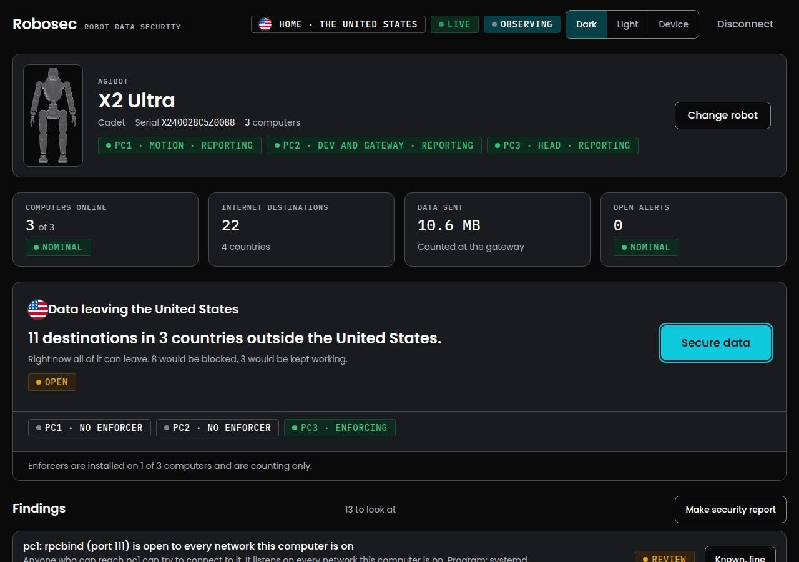
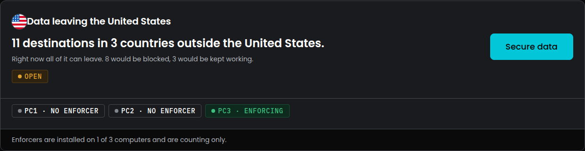
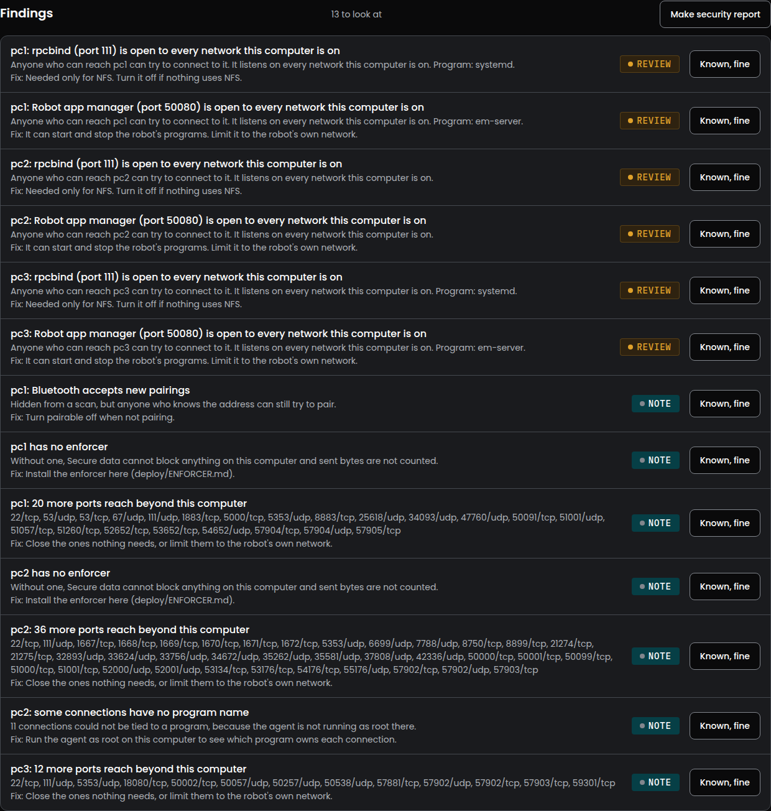
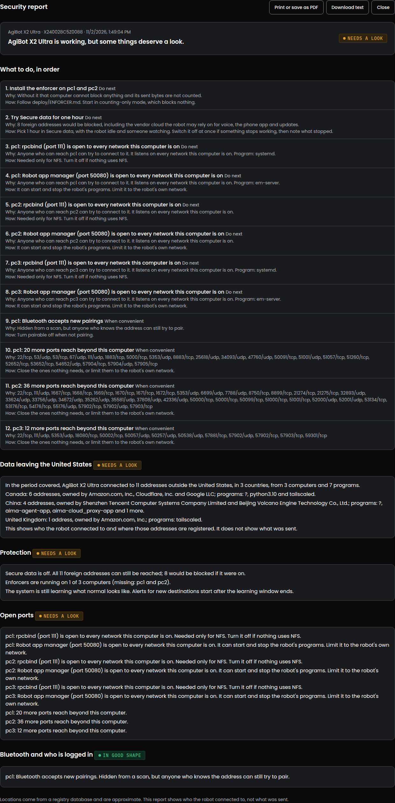
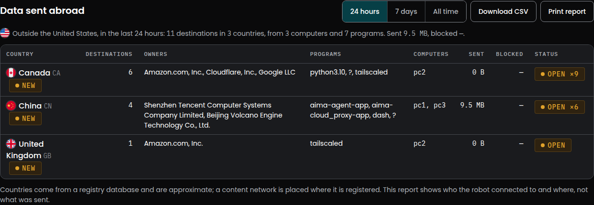
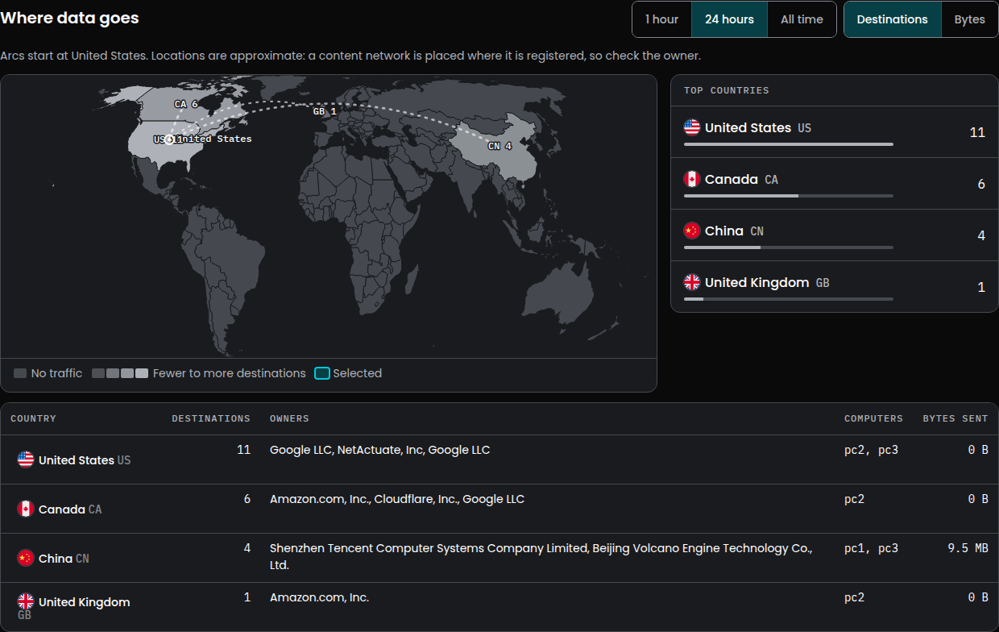
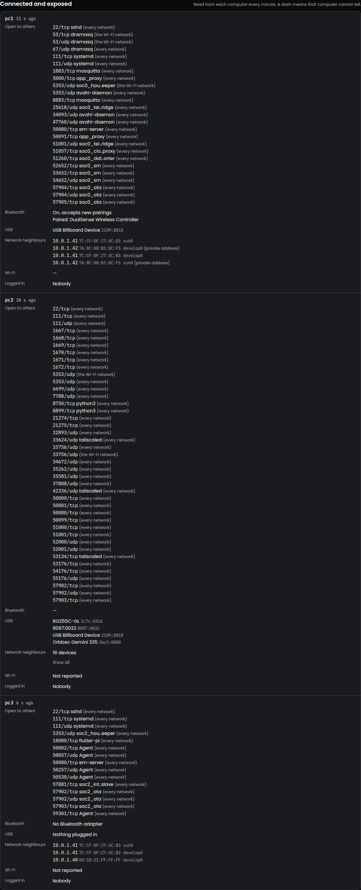

# robo-data-security (robosec)

Per-process outbound visibility and egress control for a multi-computer robot (AgiBot X2 "Cadet"), in the spirit of OpenSnitch.

## What it looks like

Live dashboard on the Cadet (AgiBot X2 Ultra). Every part is explained in [`docs/DASHBOARD.md`](docs/DASHBOARD.md).



| | |
|---|---|
| **Secure data**: block everything outside the home country, 1 hour to until off<br> | **Findings**: what could be wrong, with the fix<br> |
| **Security report**: a rating and what to do, in order<br> | **Data sent abroad**: by country, owner and program, with CSV and print<br> |
| **Where data goes**: map of the robot's destinations<br> | **Connected and exposed**: open ports, Bluetooth, USB, Wi-Fi, logins<br> |

Also: [what is leaving by category](docs/screenshots/08-what-is-leaving.png), [computers](docs/screenshots/09-computers.png), [alerts](docs/screenshots/10-alerts.png), [connections](docs/screenshots/11-connections.png), [light theme](docs/screenshots/15-light-theme.png), [phone](docs/screenshots/16-phone.png).

**Read `HANDOFF.md` first.** It has the verified facts about the robot, the architecture, the hard safety rules, the phased plan with acceptance tests, the
deployment runbook and the decisions to ask the human.

```bash
python3 -W ignore -m unittest discover -s tests -t .     # 174 tests, about 30 s, no root needed
tools/collect_phase0.sh                                   # Phase 0: read-only survey of the three robot computers
./deploy/install.sh --role all --dry-run                  # what the installer would do
```

Status: running on the Cadet (agents on PC1, PC2, PC3; server on PC2; enforcer on PC3 in counting-only mode; units are temporary and stop at a reboot, see `HANDOFF.md` 5.7). Stdlib-only Python 3.10+.
