# The robosec dashboard: every part explained

The dashboard is one page served by the robosec server (on the Cadet it runs on PC2). It shows **who the robot talks to, where in the world they are,
what is exposed, and what could be wrong**, and it holds the one big switch, **Secure data**. The screenshots below are the live dashboard on the Cadet
(AgiBot X2 Ultra), 2026-11-02, dark theme.

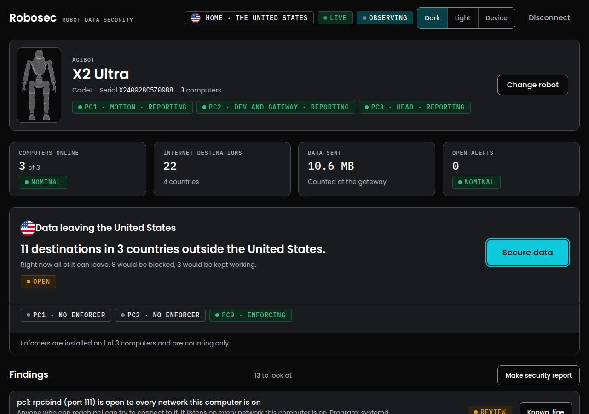

**Open it:** `http://<PC2 address>:8750/`, or from the workstation through a tunnel: `ssh -L 8760:10.0.1.41:8750 agi@<PC2 Wi-Fi address>` then
`http://127.0.0.1:8760/`. Paste the **admin token** from `server.json` into the Connect box. It stays in that browser tab only.
The page is plain HTTP with a bearer token, so use it only on a network you trust.

Words used on every screen: **Nominal** (fine), **Review** or **Open** (look at it), **Act now** (fix it first), **Note** (good to know).
Every state is a word plus a dot, never colour alone. A dash (—) means "not known", never zero.

---

## 1. Header
Top bar: the name, the **home country** chip (where the robot lives; everything outside it is "foreign"), **Live** (the dashboard is getting fresh
data; turns to "Server not answering" if not), **Observing / Enforcing** (whether the gateway policy only watches or acts), the **theme switch**
(Dark, Light, Device) and **Disconnect** (forgets the token).

## 2. Robot banner
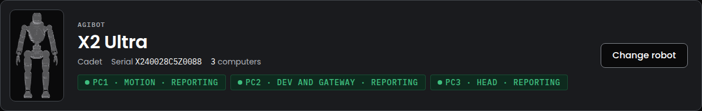

Says which robot this system protects: maker, model, your name for it (here "Cadet"), serial number, and a render of the robot. Under it, one chip per
computer in that robot (PC1 motion, PC2 development and gateway, PC3 head) showing whether it is **Reporting** or **Silent**.
**Change robot** ([screenshot](screenshots/13-choose-robot.png)) switches between the **AgiBot X2 Ultra**, **AgiBot A3** and **Unitree G1**, and sets the
name and serial. The choice is saved on the server and audited. Renders come from the NVIDIA soma-retargeter assets (licences in `dashboard/robots/`).

## 3. Status strip
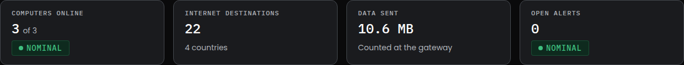

Four numbers: **computers online** (reporting now, of all known), **internet destinations** (distinct outside addresses seen, and how many countries),
**data sent** (exact bytes, only when an enforcer or the gateway counts them, otherwise a dash), **open alerts** (new things nobody has acknowledged).

## 4. Secure data
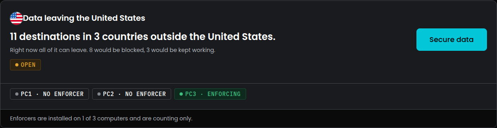

The main control. It answers: *how much of what the robot talks to is outside the home country, and can we stop it?*
- The headline counts foreign destinations and countries, and says how many **would be blocked** and how many **would be kept working** (see exempt below).
- The state chip: **Open** (switch off, foreign data can leave), **Quiet** (off, nothing foreign seen), **Waiting** (on, but no enforcer running yet),
  **Partial** (on, but not every computer has an enforcer), **Secured** (on and every computer enforcing), **Needs home** (no home country set).
- One chip per computer shows whether its **enforcer** is running and blocking, or **counting only**.
- **Secure data** opens a confirmation ([screenshot](screenshots/14-secure-data-dialog.png)). Choose **1 hour, 8 hours or until switched off**. It lists the
  countries and owners affected. Switching on blocks every foreign internet address on every computer that has an enforcer.
- **Kept working** (exempt) by default: remote access (SSH, VPN), name resolution (DNS) and time sync, and any address that is shared with one of those.
  Addresses with no known country are **never blocked**.
- Safety: the enforcer refuses to touch anything but public internet addresses, and **fails open** (stops blocking) if it cannot reach the server for 120 s.
  The switch expires by itself when its timer ends. Every change is written to the audit log.
- Blocking the robot vendor's cloud may stop voice, the phone app or updates. Try it for one hour with the robot idle and someone watching.

## 5. Findings and the security report
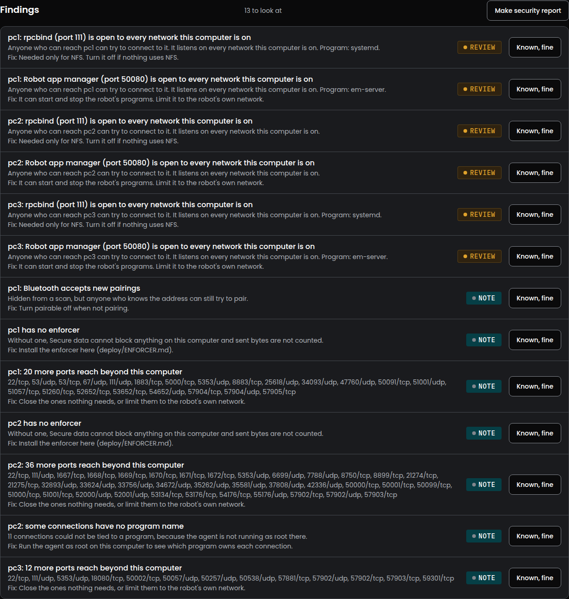

A plain-language list of what could be wrong, each with a **severity**, the evidence and a **fix**:
open ports that reach beyond the robot's own network (for example the robot app manager on port 50080, rpcbind on 111), Bluetooth that is visible or accepts
new pairings, a computer that stopped reporting, a computer with no enforcer, connections with no program name (the agent is not root).
**Known, fine** moves a finding into *Accepted findings* (and **Reopen** brings it back). The list is recomputed from live readings, so a fixed problem disappears.

**Make security report** ([screenshot](screenshots/12-security-report.png)) turns everything into one readable page: a rating (**In good shape / Needs a look /
Act now**), **What to do, in order** (numbered steps, each with why and how, marked Do first / Do next / When convenient), and sections for data leaving the home
country, protection, open ports, and Bluetooth and logins. **Print or save as PDF** prints only the report; **Download text** saves it as Markdown.
The report never guesses: unknown bytes are called unknown, and it says plainly that it shows who the robot connected to, not what was sent.

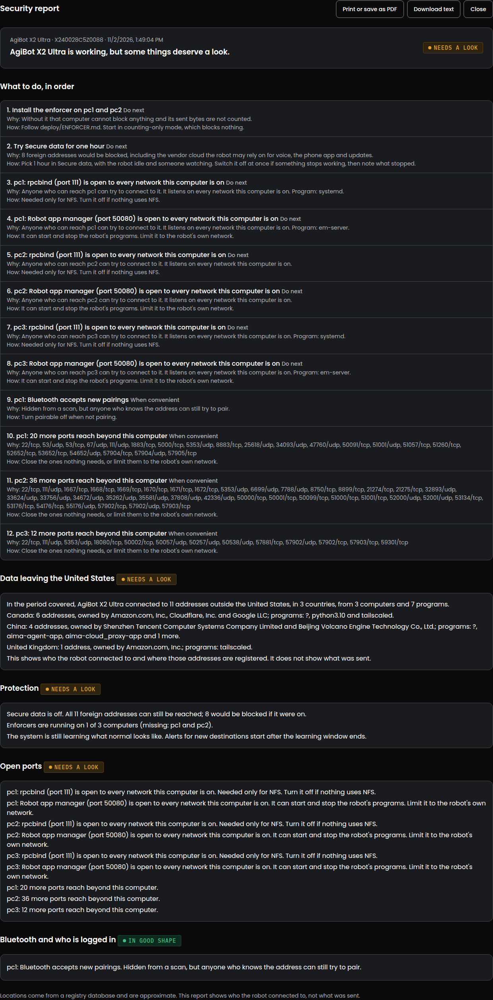

## 6. Data sent abroad
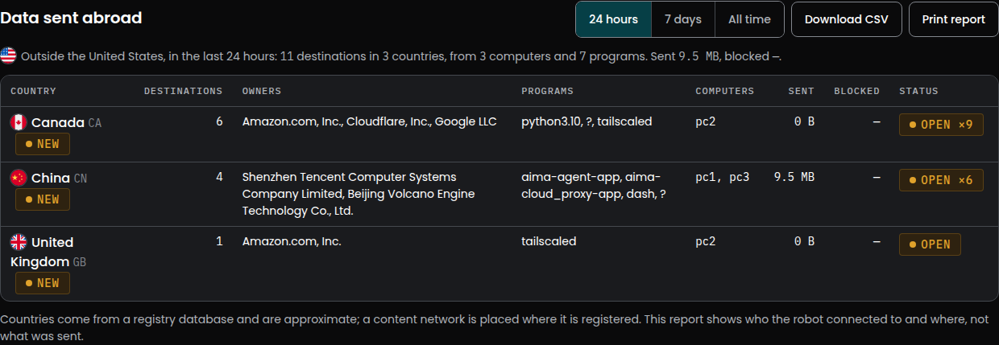

A table of every country outside home that the robot connected to: **destinations**, **owners** (who the address is registered to, such as a cloud company),
**programs** and **computers** involved, **bytes sent** and **blocked**, and a status (**Open**, **Secured**, **Kept working**). A **New** chip marks a country first seen in
the period. Pick **24 hours, 7 days or All time**. **Download CSV** gives every connection row for a spreadsheet; **Print report** prints this section with a header
(robot, date, home). Countries come from an offline registry database and are approximate: a content network is placed where it is registered.

## 7. Where data goes (map)
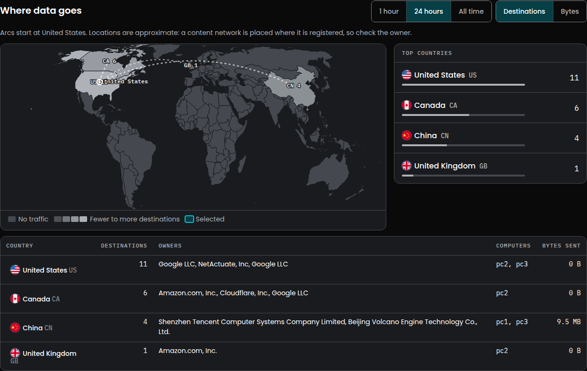

A world map with arcs from home to each country, shaded by number of destinations (or by bytes, once counted). Grey means data; blue is reserved for selection.
Click or tab to a country (or a row in the table beside it) to see its owners and computers. Everything is drawn offline from Natural Earth data. There is a table
with the same numbers for screen readers, and if no home is set no arcs are drawn.

## 8. Connected and exposed
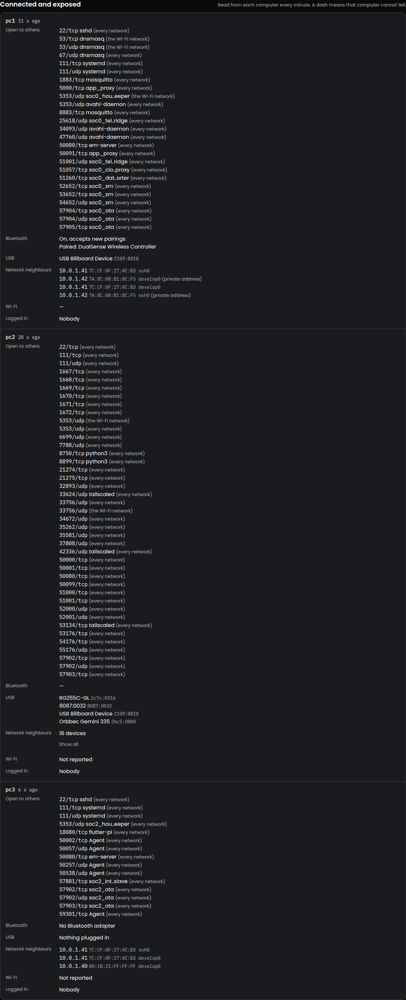

What each computer **exposes** and what is **connected to it**, read every minute by its agent without root:
- **Open to others:** each listening port, the program behind it where it can be seen, and how far it reaches: *every network*, *the Wi-Fi network*, *the robot's own network*, *this computer only*.
- **Bluetooth:** adapter state, whether it is visible or accepts new pairings, paired devices and which are connected (the DualSense controller on PC1). A dash means the
  computer cannot tell; "No Bluetooth adapter" means there is none.
- **USB:** devices plugged in (cameras, controllers, storage), hubs left out.
- **Network neighbours:** devices this computer has talked to, with a "private address" tag for randomised MACs. Long lists fold behind **Show all**.
- **Wi-Fi:** network name, signal and access point where the computer reports them (otherwise "Not reported"). **Logged in:** who is logged in and from where.
- A **New** chip and an alert appear when a device shows up that was not in the computer's first reading (its baseline).

## 9. What is leaving
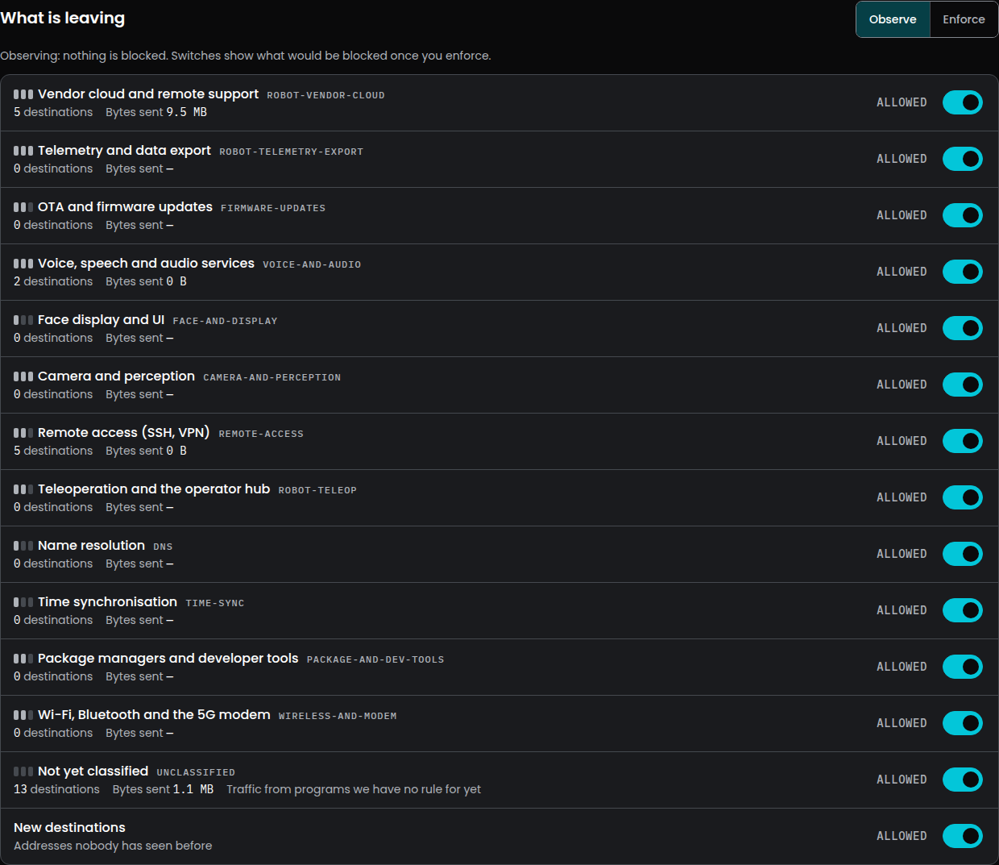

The policy view: outside destinations grouped into categories (**vendor cloud and remote support, telemetry and export, OTA and firmware, voice and audio,
camera and perception, remote access, teleoperation, DNS, time sync, package managers, wireless and modem, not yet classified**). Each shows destinations and bytes, and a switch
**Allowed / Blocked**. **Observe** only watches; **Enforce** applies the switches through the gateway. The gateway needs the `nft` tool, which is not installed on the
Cadet, so today blocking is done by the Secure data enforcer instead. A **Stop enforcement** control returns everything to Observe at once.

## 10. Computers
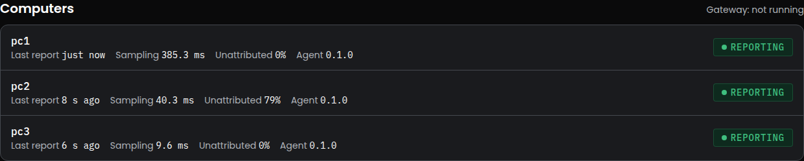

One row per computer: last report time, how long a sample takes, the share of connections with no program name (needs root on that computer), the agent version, and
**Reporting / Silent**. The line above shows the gateway state (policy version applied, or "not running").

## 11. Alerts
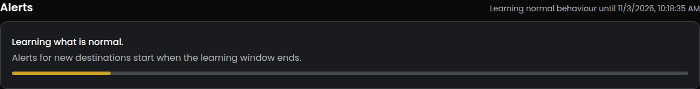

Something new and worth a look: a **new internet destination**, an **inbound connection from the internet**, a **new Bluetooth, USB or network device**. Alerts only start after the
**learning window** (24 h by default) so the robot's normal behaviour does not flood the list; a progress bar shows it. **Acknowledge** clears one.

## 12. Connections
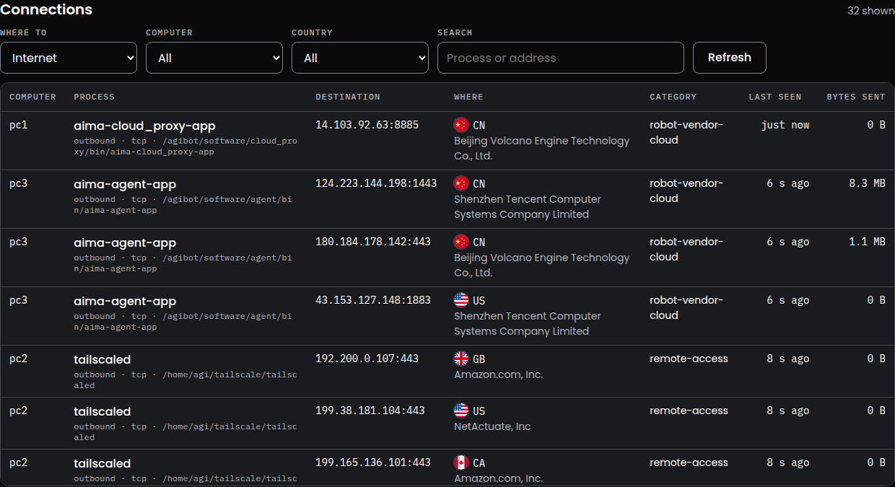

Every connection the agents have seen: computer, **program** (the real executable), **destination** with country flag and owner, category, last seen, bytes sent.
Filter by where it goes (internet, everything, local network, VPN, robot internal), computer, country, or search text.

## 13. Themes and phones
Dark is the default; Light and Device (follows the system) are one click away. The layout works at phone width with 44 px touch targets, and respects reduced motion.

| Light | Phone |
|---|---|
| 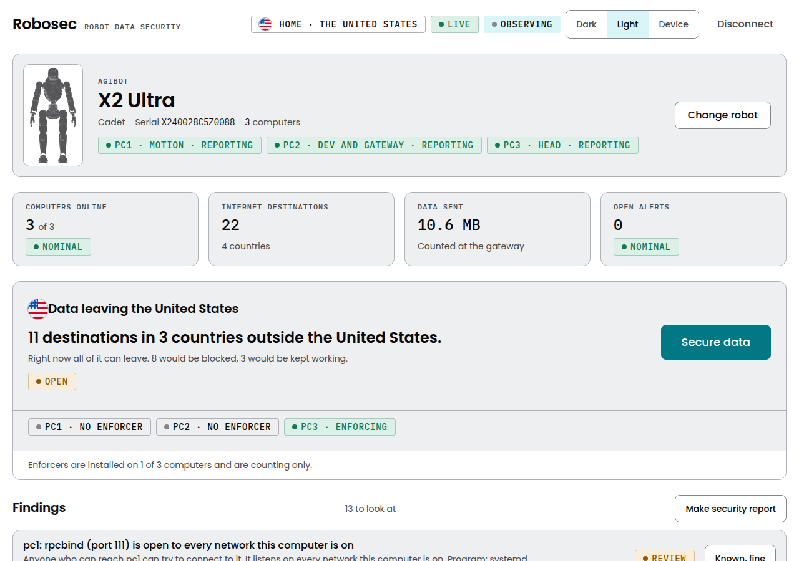 | 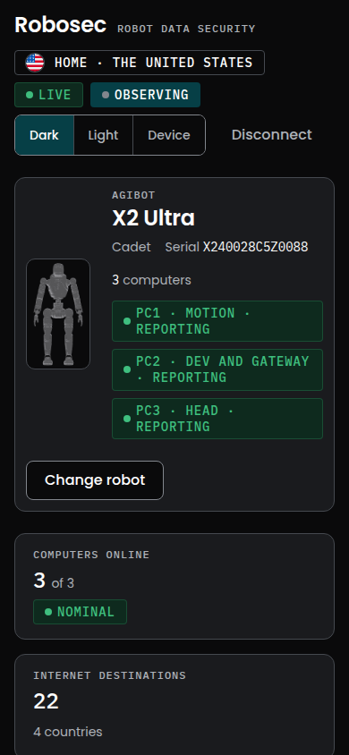 |

---

## The parts behind it

| Part | Where | What it does |
|---|---|---|
| **agent** | `robosec/agent.py`, `procnet.py`, `posture.py` | Runs on each computer. Reads `/proc` for connections and the program that owns each, and every minute the ports, Bluetooth, USB, neighbours, Wi-Fi and logins. Read-only. Never opens a port. |
| **server** | `robosec/server.py` | Stores everything in SQLite, decides scope, category and country, raises alerts, serves the API and this dashboard. Three separate tokens: agent, gateway and enforcers, admin. |
| **enforcer** | `robosec/enforcer.py`, `secure.py` | The Secure data switch on one computer: its own `iptables` chain with a DROP for each blocked address and a counting rule for the rest. Fails open. |
| **gateway** | `gatewayd.py`, `nftrender.py` | Policy firewall for PC2 as the robot's egress gateway. Written and tested, not installed (no `nft`). |
| **geolocation** | `geodb.py`, `geo/` | Offline country and owner lookup from DB-IP Lite (CC BY 4.0), shown in the footer. |
| **findings and report** | `findings.py`, `securityreport.py` | Turn readings into findings and the written report. |
| **robots** | `robots.py`, `dashboard/robots/` | Catalogue and renders of the supported robots. |

### API (admin token unless noted)
`GET /api/v1/summary`, `/robot` (and `PUT`), `/secure` (and `PUT`), `/findings`, `POST /findings/accept`, `/posture`, `/report/abroad` (`.csv`), `/report/security` (`.md`),
`/geo/summary`, `/edges`, `/alerts` (`POST /alerts/<id>/ack`), `/policy` (and `PUT`), `/audit`, `/categories`. Agents `POST /report`; enforcers use `/secure/blocklist` and `/secure/report`.

### Rules the tool keeps
Read-only agents. The enforcer only touches its own chain and never a robot-internal, LAN, VPN or local address. Nothing is blocked on a guess: an address with no
known country is left alone. Bytes are shown only when counted. Nothing leaves the robot: fonts, the map, flags and the geo database are all local, and the page makes no
outside requests.

### Regenerating these screenshots
`docs/screenshots/` was made with a headless browser logged in to the live dashboard (`tools/take_screenshots.py`). Wi-Fi neighbours of other devices are folded, so no one
else's device addresses appear. The serial number shown is the robot's own.
